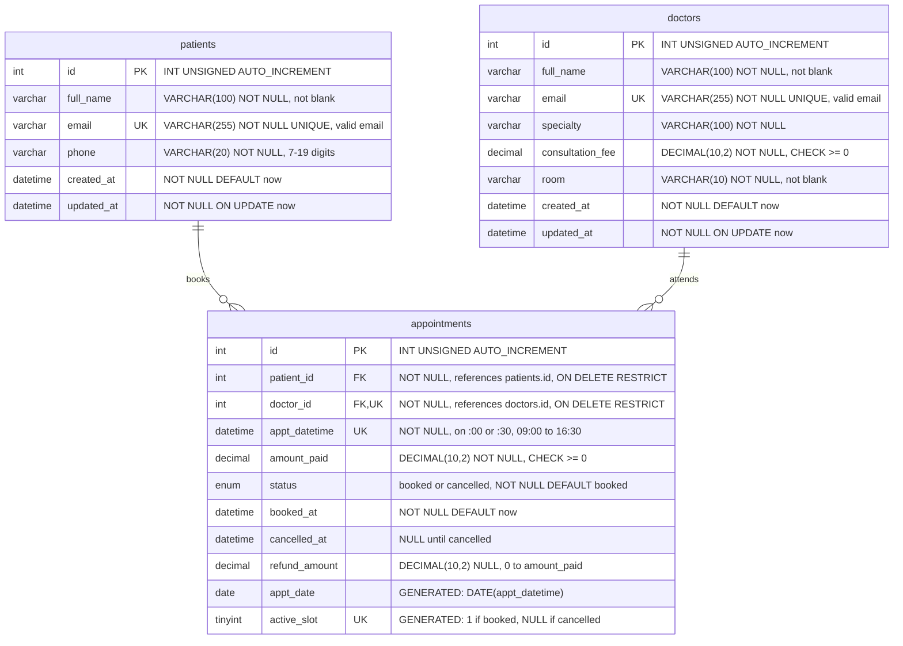

# MediBook Database

MediBook uses a MySQL 8 database called `medibook` with **exactly 3 tables**, normalized to 3NF from the clinic's original spreadsheet:

- **`patients`**: one row per person who books appointments.
- **`doctors`**: one row per doctor, with their specialty, consultation fee and room.
- **`appointments`**: links one patient to one doctor at one date and time. It also holds the cancellation and refund record. A cancelled row is **kept** (`status = 'cancelled'`) so refund history is never lost.

Relationships: one patient has many appointments, and one doctor has many appointments (both **1 : N**). The DDL is in [database/schema.sql](../database/schema.sql), sample data is in [database/seed.sql](../database/seed.sql), and the full diagram image is [schema-diagram.png](../schema-diagram.png). How the spreadsheet was normalized is explained in [database/NORMALIZATION.md](../database/NORMALIZATION.md).

## Diagram

**Key:** `PK` primary key · `FK` foreign key · `UK` unique. In `appointments`, the three `UK` columns together form **one** composite unique key, `uq_appointments_doctor_slot`.

## Business rules enforced by the database

| Rule | How |
|---|---|
| A doctor can't have two appointments at the same date and time | `UNIQUE (doctor_id, appt_datetime, active_slot)`. `active_slot` is `1` while booked and `NULL` once cancelled, and MySQL never treats two NULLs as duplicates. So only **one active** booking can exist per slot, while cancelled rows stay for history and the slot can be booked again. The index also stops two simultaneous requests from both getting the slot |
| Appointments start on 30-minute boundaries | `CHECK (MINUTE(appt_datetime) IN (0,30) AND SECOND(appt_datetime) = 0)` |
| Working hours are 09:00–17:00 | `CHECK (TIME(appt_datetime) BETWEEN '09:00' AND '16:30')`. The last slot starts at 16:30 and ends at 17:00 |
| A cancellation is all-or-nothing | `CHECK`: a `booked` row has no `cancelled_at` or `refund_amount`; a `cancelled` row has both |
| A refund can't exceed what was paid | `CHECK (refund_amount BETWEEN 0 AND amount_paid)` |
| Booking history can't be deleted | Both foreign keys use `ON DELETE RESTRICT`: a patient or doctor who has appointments can't be deleted |
| No duplicate accounts | `UNIQUE (email)` on `patients` and on `doctors` |

Two rules **can't** be written as constraints, so the API enforces them inside a transaction that locks the doctor's row:
- **The appointment must be in the future.** A `CHECK` can't use `NOW()`.
- **At most 12 appointments per doctor per day.** A `CHECK` can't count other rows.

The index `idx_appointments_doctor_day (doctor_id, appt_date, status)` makes that daily count, the doctor statistics and the busy-days report fast.
